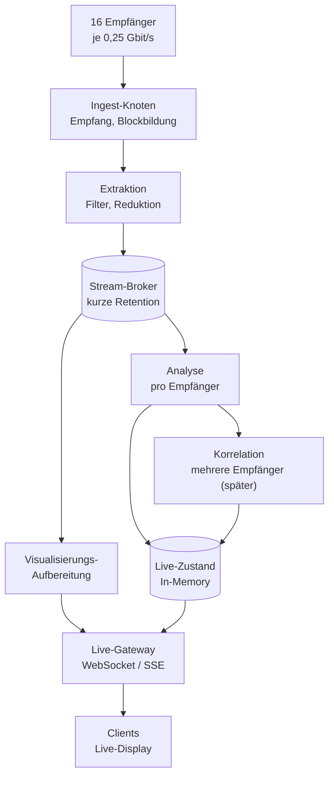

# Grobarchitektur: Live-Verarbeitung und Visualisierung von Radar-Pulsdaten

## 1. Ausgangslage und Anforderungen

| Punkt | Festlegung |
|---|---|
| Quellen | 16 Radarempfänger, je 0,25 Gbit/s (gesamt 4 Gbit/s, ca. 500 MB/s) |
| Pulse pro Quelle | ca. 100 000 Pulse/s |
| Daten | Pulsdaten (PDW) mit Zeitstempel, bereits aufbereitet |
| Felder | TOA, Frequenz, Pulsbreite, Amplitude, Einfallswinkel, Emitter Ref (optional) |
| Verarbeitung | Extraktion relevanter Daten, danach Analyse und parallel Aufbereitung für die Visualisierung |
| Anzeige | Live-Display an den Clients |
| Latenz | Puls bis Anzeige < 2 s (Planungsziel ca. 1 s) |
| Speicherung | Nicht erforderlich (nur kurzer Puffer für Neustarts und Live-Zustand im Speicher) |
| Erweiterung | Korrelation mehrerer Empfänger zu einem späteren Zeitpunkt |

## 2. Datenvolumen

- Ein PDW umfasst ca. 24 bis 32 Byte (Annahme, mit dem realen Format abgleichen).
- Einzelne Pulse werden **nicht** als Einzelnachrichten transportiert, sondern in Blöcken von 5 bis 10 ms (einige tausend Pulse).
- Rohdaten werden nicht dauerhaft gespeichert.

## 3. Architekturübersicht

Der Broker entkoppelt die Stufen. Analyse und Visualisierungs-Aufbereitung lesen unabhängig voneinander als eigene Consumer-Gruppen. Eine langsame Analyse bremst dadurch die Anzeige nicht aus.

## 4. Datenmodell

Ein PDW besteht aus:

| Feld | Größe | Anmerkung |
|---|---|---|
| TOA | 8 Byte | Nanosekunden oder feiner, gemeinsame Zeitbasis |
| Frequenz | 4 Byte | |
| Pulsbreite | 4 Byte | |
| Amplitude | 2 bis 4 Byte | |
| Einfallswinkel | 2 bis 4 Byte | |
| Emitter Ref | 4 Byte | 0 = unbekannt, nur als Hinweis (Prior) verwenden |

Transport in Blöcken (spaltenorientiert, z. B. Apache Arrow):

- Blockkopf: Receiver-ID, Sequenznummer, Zeitfenster, Pulsanzahl, Spaltenformat
- Blockinhalt: ein Array je Feld (Struct of Arrays), gut vektorisierbar

## 5. Die Stufen im Einzelnen

### 5.1 Ingest-Knoten
- Empfang der Datenströme (TCP/UDP oder Protokoll der Quelle), Verteilung auf mehrere Knoten (ein Knoten pro Quelle oder pro vier Quellen, 1 bis 10 GbE).
- Prüfung der Sequenznummern (Paketverluste erkennen) und Bündelung in Zeitblöcke.
- Zeitstempel sind bereits vorhanden. Wichtig ist eine gemeinsame Zeitbasis aller Quellen (GPS-disziplinierte Uhr, PTP).

### 5.2 Extraktion
- Filterung nach Frequenzbereich, Amplitude (SNR-Schwelle), Pulsbreite und Einfallsrichtung.
- Verworfen werden Rauschen, bekannte Störer und Pulse außerhalb des Interessenbereichs. Das senkt das Volumen oft um ein bis zwei Größenordnungen.
- Die Filterregeln sind zur Laufzeit konfigurierbar.

### 5.3 Stream-Broker (z. B. Kafka oder Redpanda)
- Partitionierung pro Empfänger, Zeitblöcke als Nachrichten, damit die Reihenfolge je Empfänger erhalten bleibt.
- Kurze Retention (wenige Minuten), nur für Wiederanlauf einzelner Stufen.

### 5.4 Analyse
1. Pulse mit gültiger Emitter Ref werden direkt zugeordnet (nur als Hinweis, nicht blind vertrauen).
2. Übrige Pulse: Clustering über Frequenz, Pulsbreite und Einfallswinkel (wegen Echtzeit bevorzugt Gitter-Histogramme).
3. Pro Cluster: PRI-Analyse über TOA-Differenzen (z. B. SDIF/CDIF, Histogramme). Ergebnis: PRI-Typ (konstant, gestaffelt, Jitter) und Scanverhalten.
4. Ergebnis: Emitter-Tracks mit Parametern und Konfidenz.

Parallelisierung pro Empfänger und Zeitfenster (gleitende Fenster von ca. 250 bis 500 ms mit Überlappung). CPU-Kerne genügen voraussichtlich. GPU oder FPGA erst bei deutlich höherer Last oder dichter Pulsumgebung.

### 5.5 Visualisierungs-Aufbereitung
Der Server berechnet fertige Kacheln mit 2 bis 10 Updates pro Sekunde:

- Wasserfall: Frequenz über Zeit (Pulsdichte)
- Polardisplay: Einfallswinkel und Amplitude
- Histogramme: PRI, Pulsbreite, Amplitude
- Emitterliste aus der Analyse
- Detaildaten (Einzelpulse) nur für einen begrenzten Ausschnitt auf Anforderung

### 5.6 Live-Gateway und Clients
- Übertragung binär über WebSocket (alternativ SSE), nur fertige Kacheln und Aggregate, keine Rohpulse.
- Horizontal skalierbar. Für neu verbundene Clients liegt der aktuelle Live-Zustand der letzten Minuten im Speicher (z. B. Redis oder Gateway-Prozess).
- Darstellung im Browser per Canvas oder WebGL.

## 6. Latenzbudget (Ziel < 2 s)

| Stufe | Budget |
|---|---|
| Ingest und Blockbildung | 50 bis 100 ms |
| Extraktion | ca. 50 ms |
| Broker | 20 bis 50 ms |
| Analyse (Fensterung) | 300 bis 500 ms |
| Visualisierungs-Aufbereitung | ca. 100 ms |
| Gateway und Rendering | 100 bis 200 ms |
| **Summe (Planung)** | **ca. 1 s** |

Die Rohpuls-Aggregate (Wasserfall, Histogramme) laufen auf dem schnellen Pfad und sind nach etwa 300 bis 500 ms sichtbar. Ergebnisse der Analyse (Emitterliste, Tracks) kommen etwas später.

## 7. Vorbereitung auf Korrelation mehrerer Empfänger

- Alle TOA beziehen sich auf eine gemeinsame Zeitbasis (Voraussetzung für TDOA).
- Die Receiver-ID steckt in jedem Block und im Datenmodell.
- Eine eigene Korrelationsstufe folgt nach der Analyse pro Empfänger und arbeitet auf Emitter-Tracks statt Rohpulsen (kleines Datenvolumen, nachrüstbar ohne Änderung der bestehenden Stufen).
- Zuordnung über Frequenz, PRI und Pulsbreite, danach über Einfallswinkel-Schnittpunkte oder TOA-Differenzen.
- Für diese Stufe wird nach Zeitscheibe statt nach Empfänger partitioniert.

## 8. Entwurfsentscheidungen

- **Backpressure:** Langsame Clients erhalten gröbere Aggregate oder verworfene Updates, die Pipeline wird nie blockiert.
- **Skalierung:** Jede Stufe ist unabhängig skalierbar (Broker dazwischen).
- **Kein Datenbank-Speicher:** Nur Broker-Puffer und In-Memory-Live-Zustand.
- **Monitoring:** Latenz je Stufe, Consumer-Lag im Broker, Paketverlust pro Quelle und Zeitsynchronisation.

## 9. Visualisierungsprototyp

Ein interaktiver Prototyp mit simulierten Daten liegt als Web-Artefakt vor und demonstriert:

- Wasserfall (Frequenz über Zeit), mit Frequenzband- und Amplitudenfilter als Abbild der Extraktionsstufe
- Polardisplay (Winkel und Amplitude) mit Emitter-Markern
- Histogramme für PRI, Pulsbreite und Amplitude
- Emitterliste mit Hervorhebung in allen Plots
- Detailfenster mit Pulsen über TOA (Frequenz auf Y, TOA auf X) für einen Emitter, einen Frequenzbereich oder mehrere Einzelfrequenzen, mit ΔTOA-Verlauf und PRI-Tendenz
- Empfängerauswahl als Vorbereitung für die spätere Korrelation

Hinweis: Im Prototyp erfolgt die Aggregation im Browser. Im Zielsystem übernimmt dies die Visualisierungs-Aufbereitung auf dem Server.

## 10. Offene Punkte

- Reales PDW-Format (Feldbreiten, Einheiten, Byte-Reihenfolge) und Übertragungsprotokoll der Quellen
- Anzahl gleichzeitiger Clients und Anforderungen an das Gateway
- Genaue Parameter der Analyse (Fenstergrößen, Clustering-Verfahren, Konfidenzmaße)
- Technologieauswahl (Broker, Stream-Processing, Programmiersprachen) abhängig von vorhandenem Know-how
- Anforderungen an die Korrelation (TDOA-Ortung, Genauigkeit, Zeitbasis)
